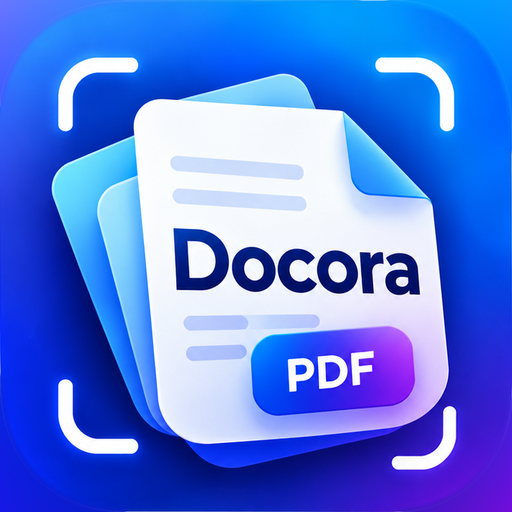

  

<h1 align="center">Docora — PDF Editor &amp; Scanner</h1>

  Scan, edit, sign, fill and translate PDFs on Android. 
  <b>Completely free</b> — no ads, no watermark, no account, works offline. 
  By Hanson · <a href="https://phoenicx.org">phoenicx.org</a>

  

  <b>Now live on Google Play:</b> <a href="https://play.google.com/store/apps/details?id=com.hanson.docora"><b>play.google.com › Docora</b></a>

  Or download the APK: <a href="https://github.com/hansonds/Docora/releases/latest/download/Docora.apk"><b>⬇ Docora.apk</b></a> (most phones) ·
  <a href="https://github.com/hansonds/Docora/releases/latest/download/Docora-all-phones.apk">All phones</a> ·
  <a href="https://hansonds.github.io/Docora/privacy/">Privacy policy</a>

---

## Features

**Edit PDF (beta)**
- Tap any line or paragraph and type: the new words keep the original font, size, colour and spacing
- Whole paragraphs open together, so you can change or delete a sentence across lines; table cells and rows stay separate
- If you type a letter the PDF's own font doesn't contain, the whole text switches to a matching font, so no letter looks different
- Bold, italic and underline for whole lines or just selected words; left, centre, right or justified alignment; widen the text box
- Move, resize, replace or delete pictures and logos
- Find & replace across the whole document
- Black out private details (removed for good when you save)
- Works on scanned pages too, with on-device text recognition
- Asks **Save / Discard / Keep editing** before you leave with unsaved changes

**Translate (new)**
- Translate selected text or a whole page into **59 languages**, on your phone
- **Translated page view**: the translation is drawn right on the page, matching the original layout, colours and text size, like a camera translator. Scroll through the pages like a normal document, tap a page to zoom, hold it to compare with the original
- Detects the language of each paragraph by itself, and works on scanned pages
- Downloaded languages are listed first
- Save the translated document as a **new PDF** (documents up to 40 pages; longer ones translate the page you're reading)
- Download only the languages you need (about 30 MB each, once), then everything works offline. Wi-Fi-only option, and delete languages any time
- Also available from full-screen reading with a small button
- If a language download stays on "waiting", Docora explains simple fixes

**Scan**
- AI scanner (Google ML Kit, on-device): accurate edge detection, auto capture, removes shadows, stains and fingers
- Built-in camera with live edge detection as a backup (choose in Settings)
- Import from photos, adjust corners by hand with a magnifier
- Filters: Auto, Magic colour, As scanned, Grayscale (shadows removed), Black & white. Pick one on the first page and the whole document uses it
- A "Processing" screen while pages are prepared; reorder, rotate or delete pages before saving
- "Keep for later" pages survive even if the phone closes the app
- Multi-page PDFs, A4 / Letter / fit, ID-card layout (both sides on one page)
- Searchable PDFs: on-device OCR adds a hidden text layer

**Read** (any PDF: thousands of pages, password-protected or damaged)
- Opens with the toolbar ready (Translate, Edit PDF, Sign, Quick fill, Text); full-screen reading on a tap, or by default if you prefer (Settings)
- Long books open almost instantly, and zoomed pages turn sharp right away
- Find text with highlighted matches, even in scans
- Smooth zoom, fast scrolling, page thumbnails, go to page, night reading
- Long-press to select, copy, share or translate text
- Opened a PDF from WhatsApp or another app? Back takes you straight back there

**Sign, fill & mark up**
- Signatures from a photo (background removed automatically) or drawn by finger; save them as transparent PNG (always 4:3)
- Choose the signature colour when you place it (original, black, blue and more), and recolour saved or placed signatures any time
- Fill PDF forms in place; Quick fill for your name, initials, address and more
- Add text, draw, highlight, shapes, whiteout, images and stamps: move, resize and rotate; undo / redo
- Small items like ✓ marks and dates get a finger-sized grab area; the delete button only works on a clear tap, and "Undo" brings a deleted item back

**PDF tools**
- Merge (drag to reorder), split, extract and organize pages
- Compress with four levels, and see the new size before you share
- PDF → JPG, images → PDF
- Extract text with OCR (English, German and other Latin-script languages; Hindi / Devanagari)
- Lock with a password (AES) or remove a password
- Watermark, page numbers, print
- Shows progress while a file opens, and a clear message if nothing was chosen or a tool was cancelled

**Your files**
- Recently opened and recently edited, in separate tabs
- PDFs opened from WhatsApp, Gmail or Files stay available later
- Save over the original or as a new copy; share with size options for WhatsApp and email
- Temporary files clean themselves up, without touching your recent files or signatures

**Look**
- Light, dark or system theme, 7 accent colours, pure black mode
- Modern icons and layout, rounded dialogs and Docora's own message style; works on phones and tablets

**Share & rate**
- **Share Docora** from the home screen, About or Settings: sends a picture with the features, a QR code and the Play Store link to WhatsApp, Messages or any app
- Rate Docora on Google Play from About or Settings; Google's review panel appears only occasionally, never on the first days

Saved PDFs appear in the app and in **Downloads › Docora**.

## Privacy

Everything is processed on your phone. Your documents, scans, signatures and the text you translate are never uploaded. Translation languages are downloaded from Google only when you ask for one. See the [privacy policy](https://hansonds.github.io/Docora/privacy/).

## Downloads

**Recommended:** install from [**Google Play**](https://play.google.com/store/apps/details?id=com.hanson.docora). You get automatic updates.

Every [release](https://github.com/hansonds/Docora/releases) also has:

| File | For |
|---|---|
| **Docora.apk** | Almost every phone from 2017 onwards (64-bit), including Samsung Galaxy S-series. Smallest download |
| **Docora-all-phones.apk** | Any Android phone, including older 32-bit models |
| **Docora-playstore.aab** | Uploading to Google Play Console |

Requires Android 8.0 or newer.

## Google Play

Store listing material is in [`playstore/`](playstore): 512×512 icon, feature graphic, privacy policy and listing text ([STORE_LISTING.md](playstore/STORE_LISTING.md)).

## Building

GitHub Actions builds the app on every push to `main`, checks 16 KB page-size support and publishes the files above under [Releases](https://github.com/hansonds/Docora/releases).

## Tech

Kotlin, AndroidX, Material 3, CameraX, OpenCV 4.12 (edge detection, perspective correction, filters), PdfBox-Android (PDF reading and editing), Google ML Kit (document scanner, text recognition, language identification, on-device translation). Liberation fonts (SIL OFL 1.1). minSdk 26, targetSdk 36, 16 KB page-size ready.
